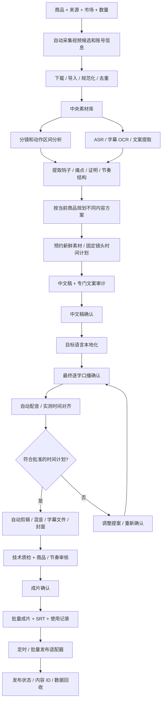
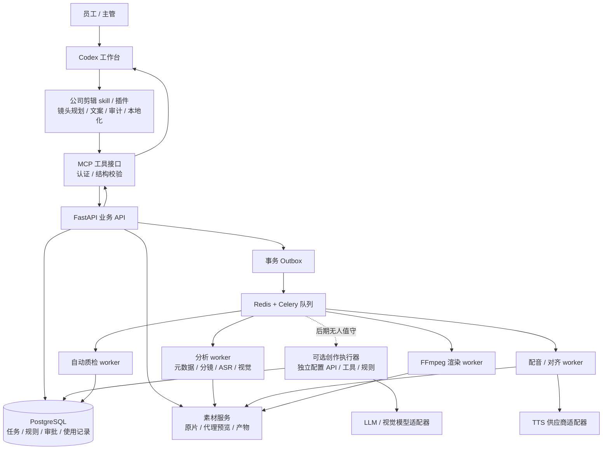
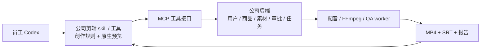

# 团队商品短视频工作流：架构提案

日期：2026-10-09（Asia/Shanghai）  
状态：完整架构提案；已实现 Codex 直接调用的任务/素材底座，见 [阶段验收](阶段验收.md)。旧网页原型移出当前开发主线，团队部署、完整媒体自动化与生产吞吐尚未验证。  
基础：现有 `mexico-tiktok-product-editor` skill；默认市场墨西哥，后续通过市场配置扩展巴西。
员工入口：Codex；公司剪辑 skill/工具调用后台服务。套壳属于后续独立需求，当前实现工作流本身。

## 0. 目标工作流：对应用户提供的视频

交付目标是可供多名员工提交、执行、审核、领取成片并发布到目标账号的批量视频生产工作流。用户提供的视频是业务流程参考：00:06–00:18 列举采集、下载、分镜、内容提取和成片；00:21–00:30 口述执行顺序；00:33–00:45 展示配音/剪辑并宣称并行；00:47–01:29 播放多条商品视频。视频未展示源代码、接口、连续生产日志，产量不作为验收保证。

### 一次提交到批量交付

输入合同：商品/SKU、目标市场、真实卖点、参考链接/同行账号/素材目录、目标成片数量、长度范围、预算和规则版本。

员工在 Codex 发起任务、创作和审核；媒体阶段由后端持续调度，检查点保存在数据库。已提交的采集、分析、配音、渲染和质检任务不依赖聊天窗口持续打开。首期创作由员工的 Codex 执行；关闭 Codex 后若下一节点需要创作或人工确认，任务保留状态等待恢复。要实现无人值守连续创作，需另配模型 API 或经验证的非交互执行器。

### 视频步骤与实际开发节点

| 视频步骤 | 本系统节点 | 产物 |
|---|---|---|
| 采集同行视频和 ID | Collector 按来源适配器采集，记录筛选依据 | SourceCandidate、ReferenceRecord |
| 下载去水印 | Downloader 获取可用原片，记录水印风险并规范格式；具体来源能力独立实测 | Asset、Preview |
| 分镜 | Analyzer 合并场景变化、动作区间、结果镜头 | Shot、ActionSpan、RiskSpan |
| 提取文案与爆款内容 | ASR + OCR + 视觉/文本分析 | Transcript、ReferencePattern |
| 重新生成 | Planner/Writer 按当前商品与可用镜头重构文案和证明链 | EditPlan、ScriptVersion |
| 自动配音 | VoiceWorker 合成固定批准原文 | VoiceTrack、TimingReport |
| 自动剪辑成片 | RenderWorker 执行结构化时间轴 | MP4、SRT、Cover |
| 多线程跑批量 | 队列按资源类型调度多个任务，跨任务公平排队 | Batch、TaskAttempt、成本记录 |

“重新生成”默认指文案和剪辑方案的再创作；素材视频中没有充分证据证明所有镜头都重新用 AI 生成。AI 补料为独立可选分支，接已有 `ai-video-generation` 规则并记录费用、产品一致性和素材 QA。

批量内容差异来自不同痛点、钩子、证明顺序、使用场景和声音方案；这些变化必须有素材支撑。原始分镜分析可缓存共享，但最终用料受七天禁复用规则约束。

员工日常通过 Codex 操作完整链路。n8n 可作为后期外围触发和系统对接层；长媒体任务由后端队列执行。团队审批、素材预约和业务状态只有一个数据库真相，聊天记录与其他编排工具只展示或调用这些状态。

## 1. 推荐决策

采用**Codex 员工工作台 + 公司剪辑 skill/插件 + MCP 工具接口 + 共享任务/素材服务 + 独立媒体 worker**。Codex 承接员工自然语言操作、理解素材、规划镜头、写稿和修改；后端执行第 0 节的媒体链路，保存版本、审批、素材预约、费用和产物。

现有剪辑 skill 保留为 Codex 的工作流规范，并把硬约束同步为后端校验。员工沿用 Codex，任务、素材、镜头、稿件、审批和成片直接在对话里展示与操作。当前实施不包含网页工作台；将来用户要求套壳时再独立设计。

Codex 是员工操作平台；共享后端是团队生产基础设施。首期完成条件仍是从来源输入到可交付成片的完整流程。可复用 Codex 的对话、skill、工具调用和文件展示，视频编码复用 FFmpeg。当前调研未确认 Codex 提供可直接替代渲染服务的内置完整剪辑引擎。

首期在公司局域网的常驻主机上部署；远程协作可经已有 VPN 或带身份控制的访问入口接入。相同应用结构可迁到云端，渲染节点可留在公司。多机协作通过 API 和素材服务完成，员工无需维护本地数据库或手动共享盘符。

优先复用现有自动剪辑项目的核心函数；若只能获得 skill，则以这些规则设计新应用。当前 Mac 工作区没有应用源码，`mexico-tiktok-auto-editor` 提到的 `F:\mexico-tiktok-auto-editor` 未获得，不能认定已经完成代码审查或可直接迁移。

### 三种可选部署

| 方案 | 优点 | 代价 | 建议 |
|---|---|---|---|
| 每人 Codex + 本地剪辑脚本 | 单机试验快 | 素材和规则分裂、重复用料、各自配置密钥、关机中断 | 仅适合开发试验 |
| Codex + 公司共享后端/worker | 素材统一、审批统一、现有硬件可复用 | 需要常驻主机、备份和维护 | 第一版推荐 |
| Codex + 云后端/云或公司渲染 | 异地访问方便、可扩容 | 视频上传、存储、出网和算力费用更高 | 异地团队或规模增长后评估 |

三种部署均可保留 Codex 入口。公司或云是后端部署位置，轻量网页是可选展示方式，两者无需绑定为不同产品。

## 2. 调研结果及借鉴边界

以下官方仓库/文档于 2026-10-09 读取。文档能力与本机实测分开：本轮未安装或跑通这些项目，也未核实它们的所有平台、配音供应商或发布能力。

| 参考 | 查到的结构/能力 | 本项目借鉴 | 需要补充或隔离 |
|---|---|---|---|
| [MoneyPrinterTurbo](https://github.com/harry0703/MoneyPrinterTurbo) | README 描述脚本、素材、配音、字幕、音乐、合成及批量任务；`app/services/task.py` 有分阶段服务和任务状态处理 | 媒体流水线拆分、供应商适配器、任务产物和历史 | 商品证据链、团队审批、素材预约需要独立实现；README 中发布能力不作为已验证接口 |
| [ShortGPT](https://github.com/RayVentura/ShortGPT) | `ContentShortEngine`、`ContentTranslationEngine`、JSON/Editing Markup Language 驱动 `EditingEngine`；README 使用 TinyDB 持久化 | 结构化剪辑计划、创作与渲染分离 | 团队状态和并发迁入 Postgres；不直接沿用单机存储方案 |
| [Auto-Editor](https://github.com/WyattBlue/auto-editor) | 按音量、运动等方法剪除低信息段，并导出编辑器工程 | 粗筛低信息段、可编辑交付思路 | 静音不等于无价值；不能自动切断无声商品操作和证明动作 |
| [pyJianYingDraft](https://github.com/GuanYixuan/pyJianYingDraft) | Python 生成剪映草稿；README 列明版本、模板可读性、Windows 自动导出限制 | 可选的剪映草稿交付适配器 | 自动导出依赖旧版可见控件；Mac/Linux 不支持自动导出；不作为主渲染引擎，也不等同 CapCut 通用兼容 |
| [LangGraph interrupts](https://docs.langchain.com/oss/python/langgraph/interrupts) | checkpoint、`thread_id`、暂停和恢复；恢复时被中断节点从头执行 | 持久化审批和有限 AI 迭代的模式 | 重复执行可能重复产生外部副作用；首期用显式数据库状态机即可 |
| [Temporal](https://docs.temporal.io/workflows) | 工作流事件历史、重放、Activities 承载外部操作 | 长任务恢复、远程任务等待、可靠工作流思想 | 首期引入会增加运维；将来复杂长流程增长后单独评估替换编排层 |
| [Remotion renderer](https://www.remotion.dev/docs/renderer) | 服务端 `renderMedia` / `renderStill` / `renderFrames` | 复杂字幕、封面和动态图形的可选渲染适配器 | 团队商业使用需按实际许可核算，首期 FFmpeg 足够 |
| [OpenTimelineIO](https://opentimelineio.readthedocs.io/en/latest/) | 镜头、时间、轨道、转场、标记、元数据的编辑交换格式；媒体外部引用 | 时间轴交换格式与导出适配器设计 | 不负责成片渲染；各编辑器效果映射需要兼容测试 |
| [n8n queue mode](https://docs.n8n.io/hosting/scaling/queue-mode/) | 主实例、Redis 队列、worker 与共享数据库结构 | 可作为外围触发和系统对接层 | 视频字节不放工作流消息；核心剪辑、素材预约和审批状态由本应用掌握 |

建议组合：借鉴 MoneyPrinterTurbo 的服务拆分、ShortGPT 的 JSON 时间轴、LangGraph/Temporal 的持久化思想，落成自己的商品视频业务系统。不是完整复制某个“通用一键生成器”。

## 3. 系统结构

这些是逻辑模块，不是首期必须拆开的十几个微服务。第一版只有一个业务 API 应用和少量不同资源类型的 worker 进程。

### 技术选择

- 工作台：员工现有 Codex。公司发布版本化 skill/插件，通过 MCP 调用后端；首次部署验证员工实际版本、账号、插件/MCP 能力和网络访问。
- 员工展示：Codex 原生文件与媒体预览、稿件文本、任务摘要。当前不建设前端工作台。独立本地脚本可直接运行，MCP 后续统一接共享 API。
- 创作执行：首期在 Codex 中运行现有 skill 的角色流程，读取分析结果并保存结构化计划/脚本。后期无人值守另配 API 创作 worker，复用规则与合同并记录模型成本。
- 后端：Python + FastAPI + Pydantic + SQLAlchemy + Alembic。创作输出通过结构校验后入库。
- 业务数据库：PostgreSQL，从首期就支持多人事务，不共享 SQLite 文件或依靠 Markdown 竞争写入。
- 异步执行：Celery + Redis，Linux worker 优先；审批与任务真相保存在 Postgres，Redis 只承担调度。
- 文件：素材服务后接常驻主机磁盘/NAS，提供稳定 asset ID、可恢复上传、Range 预览和访问控制；后续适配 S3 兼容对象存储。
- 视频：FFprobe/FFmpeg 负责规范化、转码、裁切、拼接、混音和检测；PySceneDetect 辅助切分场景，ASR/视觉模型再理解动作。
- ASR：供应商适配器，可评估 faster-whisper 等本地实现；Apple Silicon 与 Linux/NVIDIA 的部署单独验证。
- TTS：统一接口，音色按墨西哥口音、清晰度、时长、费用做样片测试。Kokoro 可评估低成本候选，但“支持西语”不等于已经验证墨西哥口音。
- 编辑工程：自己的版本化 TimelineManifest 为真相；OTIO 或剪映草稿均由适配器导出。
- 运行：开发环境用 Docker Compose；团队发布要有版本锁、健康检查、数据库迁移、备份和恢复流程。

初期不同时叠加 Celery、LangGraph、Temporal 三套主编排。主业务状态机 + Celery 执行即可。未来引入 LangGraph 时只负责受限创作子流程；Temporal 需要独立的迁移设计。

## 4. 员工实际操作

1. 员工在 Codex 说：“用这些素材，为这款商品制作 5 条墨西哥视频，预算上限为……”；skill 整理商品、市场、真实卖点、来源、数量与预算，通过 MCP 建立批次，返回可恢复的任务 ID。
2. 后台导入/采集和分析素材。Codex 获取镜头、动作、文字与风险结果，先预约新鲜素材，再规划每条的镜头时间。素材不足明确等待补料；5 条目标不自动豁免七天禁复用。
3. Codex 生成中文导演稿，执行独立文案审计，保存指定版本并提交审核。员工在 Codex 明确确认批准的具体版本；跨员工审核从任务 ID 读取同一版本。
4. 中文批准后，Codex 本地化为 es-MX，展示逐字原文、计划时长、声音/速度、镜头与字幕/封面设置，获得最终确认。
5. Codex 提交批准版本；后台配音、对齐、渲染和质检。员工关闭 Codex 后这些已提交任务继续执行；需要改时间或内容则保存修订状态，恢复后重新确认。
6. 员工在 Codex 说：“查看这个批次的结果”；取得预览、质检报告、MP4、SRT 和可选工程包。审核员确认成片后才交付并登记素材使用。

Codex 展示任务摘要、文案、媒体与待办，可批量批准已经审阅的指定版本；大量任务使用分页工具返回，套壳后续再考虑。未经审阅的新版本不会继承批次批准。新开 Codex 对话输入任务 ID 即可从后端恢复，聊天记录不是唯一进度来源。发布已纳入最终完整工作流，分阶段接入；第一步本地验收版的完成条件不包含实际发布。

## 5. 八个 Agent 如何接入团队工作流

| skill 角色 | 服务职责 | 主要结构化产物 | 可并行的范围 |
|---|---|---|---|
| 素材筛选 | 递归扫描、重复检测、风险标记 | Asset、Shot、RiskSpan | 不同素材并行，结果缓存复用 |
| 剪辑结构 | 选段、顺序、动作完整性、时长预算 | EditPlan、TimelineManifest | 不同任务并行；先预约再选用 |
| 中文文案 | 钩子、具体痛点、转折、证明、结果、CTA | ScriptVersion.zh | 依赖镜头计划 |
| 文案审计 | 拒绝广告腔、口号、过度整齐和无证据卖点 | AuditReport、修订建议 | 文案完成后；最多两轮自动修订，仍失败交人工 |
| 墨西哥本地化 | 目标市场表达、商品名称和单位 | ScriptVersion.es-MX | 中文确认后 |
| 配音/字幕 | 固定批准稿 TTS、分段对齐、时长校验 | VoiceTrack、SRT、TimingReport | 最终原文确认后 |
| 封面/包装 | 封面图、标题及可选字幕样式 | Cover、StyleManifest | 配置批准后可与音频处理并行 |
| 最终 QA | 技术检测和语义/人工审核 | QAReport、交付结论 | 渲染完成后 |

Agent 是职责，不要求每名员工启动八个常驻 AI。首期创作与审计角色在 Codex 中按 skill 执行；文件处理、配音、渲染和硬约束由服务执行。若客户端无法运行独立审计角色，需要接一个独立审计执行器并验证，不能把作者自评等同独立审计。模型不能自行批准、改共享规则、扣除未知费用或将任务标记为人工验收通过。

## 6. 数据与版本合同

### 核心实体

| 实体 | 必须记录 |
|---|---|
| Team / User / Role | 团队、制作员、审核员、管理员及项目访问范围 |
| Product | SKU、市场、规格、外观锁、卖点和证据来源 |
| Asset / AssetFamily | 来源、原文件哈希、商品关联、近重复族、尺寸、音轨和预览 |
| Shot / RiskSpan | 源起止点、动作起点/完成点、结果点、风险区间、证据关联 |
| Job / Batch | 负责人、版本、规则快照、目标数量、状态、预算 |
| EditPlan / TimelineManifest | 镜头顺序、源区间、裁切、速度、轨道、总帧数 |
| ScriptVersion | 中文和最终西语原文、结构标签、证据引用和文案审计 |
| Approval | 审批种类、版本哈希、批准者、时间、拒绝理由 |
| AssetReservation / AssetUsage | 排他预约、租约、心跳、最终使用时间和任务 |
| TaskAttempt / ProviderRequest | 重试号、幂等键、外部任务 ID、费用和恢复状态 |
| Artifact / QAReport | 产物哈希、版本、检测区间、人工结论及交付位置 |
| RuleSet / Feedback | 团队、项目、任务规则及有来源的偏好变更 |

素材字节保存在文件/对象存储；数据库保存索引、版本和引用；队列只传 ID。时间轴使用整数帧数/有理帧率，并处理源素材 VFR/旋转元数据，避免浮点累积和手机竖屏误裁。

TimelineManifest 至少包含：schema_version、job_version、fps、总帧数、素材 ID/哈希、每个源入出点、时间轴入出帧、裁切、速度、音轨、字幕引用、封面配置、规则快照 ID。多种渲染器只读取该合同，不自行再写一版文案或重选素材。

### 审批锁

默认保留现有的两阶段确认：中文导演稿批准后再本地化；最终西语逐字文本批准后才合成声音。不能因为做了平台就自动省掉其中一关。

最终 ApprovalManifest 绑定中文意图、最终西语、镜头计划、计划时长、声音/速度、字幕、封面、规则版本和素材哈希。采用规范化内容序列化 + 内容哈希；后台用服务端账户和角色权限记录审批，并核验真实确认，而不是相信工具或页面传来的 `approved=true`。在 Codex 展示固定版本并取得真人明确回复，再保存绑定版本的确认记录。独立后台的团队审批权依赖可信身份与确认凭据；审批阶段需验证宿主确认机制或设计专用确认工具，普通模型工具调用不能自行充当真人确认凭据。当前本机底座尚未实现审批，不因此提前建设网页。

批准后任何可见/可听字段变化都创建新版本并使相关批准失效。worker 开始前和提交产物前都核对版本；旧版本结果保留历史但不能覆盖当前交付。

审批前时长只是估计。首次批准锁定计划与声音配置，配音后使用真实时间校验。默认发现不符即提交修订提案；不得自动缩文、改速度、拉长静态画面。若将来需要允许微小时间调整，必须把明确的容差范围作为用户批准合同的一部分。

## 7. 状态机与恢复

主成功路径：

`CREATED → INGESTING → ANALYZING → PLANNING → SCRIPT_AUDIT → AWAITING_ZH_APPROVAL → LOCALIZING → AWAITING_VO_APPROVAL → VOICING → TIMING_VALIDATION → RENDERING → AUTO_QA → AWAITING_FINAL_REVIEW → DELIVERED`

旁路状态：`NEEDS_MATERIAL`、`NEEDS_REVISION`、`FAILED_RETRYABLE`、`FAILED_FINAL`、`NEEDS_RECONCILIATION`、`CANCELLED`。

- 每一阶段保存输入版本、参数、代码/模型版本、结果引用和错误。
- 修改商品或素材影响分析后所有依赖；改文案使本地化、声音、字幕、时间计划和成片失效；只修改存储目的地不用重做内容。
- 审批期间释放占用的 worker，状态持久化到 DB；员工关闭 Codex 不改变已提交媒体任务。等待 Codex 创作的节点保存为待处理状态，按任务 ID 恢复。
- 数据库事务提交状态变更和 Outbox 事件；调度器发送 Celery 消息。事件发送失败可重试，重复发送由消费者幂等处理。
- worker 有租约和心跳，过期任务由恢复器检查，不能仅靠 Celery 的默认确认方式承诺崩溃恢复。
- 每阶段幂等键取任务版本、阶段、输入哈希和配置版本；输出临时写入后校验并原子提交。重试同一阶段不重复登记素材使用。
- 云生成先保存 provider request ID，再轮询或接收回调。请求超时且供应商没有幂等/查单能力时进入对账状态，禁止盲目再付费提交。
- 取消任务终止可控子进程；外部任务是否可取消取决于供应商，继续查询已产生费用的请求并释放不用的素材预约。

参考 [Celery tasks](https://docs.celeryq.dev/en/stable/userguide/tasks.html) 的幂等、确认和 worker 丢失行为。`acks_late` 不是“绝不丢任务”或“恰好执行一次”的保证。

## 8. 团队素材管理与七天规则

数据库事务中锁定素材内容族，检查最近使用和有效预约，再取得排他租约；另一个任务竞争同一素材时明确等待或改选。预约、取消、过期、交付都保留事件。

审批可能持续数天：预约有心跳和可配置过期时间。过期后恢复任务必须重新检查素材，计划变化重新审批。以成功交付时间记录使用；重复交付同一任务版本幂等。长期占用不能靠无限租约隐藏。

文件改名不逃过 SHA-256；不同清晰度、压缩和裁切的近重复由感知指纹/镜头比对形成候选内容族，低置信度由人工确认，避免错合并。

严格七天禁复用与“同素材批量生成不同版本”冲突。默认不豁免变体。如果需要批次内复用或不同账号间复用，必须单独确认规则的范围并版本化，不能在程序里默认绕开。

只作容量示例：若每条用 2–3 份完全独立源素材，严格禁复用下每天 3000 条意味着每天新增约 6000–9000 份可用素材，连续七天为约 4.2–6.3 万份。这不是已验证需求量，而是说明素材供给可能先于渲染成为瓶颈。

## 9. 商品证明与质量门槛

每个文案卖点关联 ProductClaim、证据来源和 proof shot。相似商品素材可作场景氛围，不能默认充当当前 SKU 的功能证明。输入网页、OCR、字幕和参考视频只当资料，不能修改系统指令、访问权限或审批状态。

镜头分析保存完整动作的起点、关键操作、完成与结果；计划校验这些必要点是否保留。场景切分并不能单独证明动作完整性，视觉模型只能辅助标记，最终商品一致性和可信度由审核员判断。

| 门槛 | 自动检查 | 人工检查 |
|---|---|---|
| 文件 | 可解码、旋转、9:16、时长、H.264/AAC、yuv420p、faststart | 画面裁切是否损失操作 |
| 节奏 | 黑帧、静音、冻结候选、过长尾部 | 动作是否完整、故事是否倒退 |
| 口播 | 批准原文哈希一致、实测分段时间、声音长度 | 墨西哥口语、音色、错读商品名称 |
| 字幕 | 时间范围、分段、版面范围、字体存在 | 语义与口播对应、移动端可读性 |
| 商品 | SKU 标签和证据引用存在、风险区间未入选 | 商品外观/机制正确、结果可信 |
| 差异性 | 最近痛点/钩子/镜头序列/指纹相似度 | 是否只是换顺序的近重复 |

按现有 skill，`freezedetect` 报告 ≥0.8 秒段必须检查并重剪，不能自动解释为正常展示。建议门槛分为硬错误、需人工复核和质量提示；模型单一“80 分”不充当技术或语义合格证明。

默认交付干净视频 + 独立 SRT；字幕和标题烧录仅在任务明确开启后执行，封面可作为独立图片。平台安全区使用可配置市场/平台模板，不把某个固定像素位置当永久标准。

技术检测参考 [FFmpeg filters](https://ffmpeg.org/ffmpeg-filters.html)，包括 blackdetect、freezedetect、silencedetect。首次渲染后人工抽检开头、关键动作、每个切点附近和最后一秒。

## 10. 采集、参考学习和 AI 补料

采集目标为 TikTok 爆款商品带货内容：优先同款高表现带货视频，再以同类高表现视频研究结构，补指定竞品/达人账号与品牌/供应商原片。记录可见播放/互动、发布时间及可取得的账号基线；Creative Center Top Ads 作为补充，付费投放不是入选前提。要求商品匹配、推广意图、钩子/场景、实际演示/结果与购买引导；默认不采通用库存或无关生活片段。具体合同见 [采集规则](采集规则-TikTok商品广告.md)。SourceAdapter 记录广告发现、预览和下载状态，不把未验证的下载或投放指标当作成功。

“参考学习库”与“可用于成片的素材库”分开。前者提取钩子机制、痛点、证明链和节奏，产出 ReferencePattern；后者记录实际商品、文件及使用记录。播放量不等于转化效果，研究结论标注数据出处和时间。

下载链路区分“取得可用原片”和“后期画面处理”，不把自动去水印当作每个平台都稳定可实现的固定阶段；不可用的来源转候选备用或等人工导入。

素材不足时明确进入 NEEDS_MATERIAL。未来 AI 补料接口可以对接现有 `ai-video-generation` 工作流，但提交数量、预算、产品外观锁和结果审核独立记录；视频生成任务进入队列，不阻塞整个业务 API，也不能用 AI 幻化动作冒充真实商品证明。

## 11. 资源、费用与部署

按分析、创作、配音、渲染、QA 分队列。联网/模型调用可以较高并发，GPU ASR/视觉和视频渲染按显存、CPU、磁盘带宽限制并发。首期每台渲染主机 1–2 个渲染槽只是起测配置，不是性能保证；worker 分配时只加载需要的模型。

员工人数决定登录和审批负载；同时处理的视频数、模型配置、原片码率、目标分辨率决定算力。先用现有闲置常驻主机试测，不在员工人数和视频负载未知时给“某张卡够多少人”的承诺。

测试维度：5/10/20 个并发任务档位；每档采集阶段 p50/p95、队列等待、失败率、一次审核通过率、每条成本、CPU/RAM/显存、磁盘读写。先小档，资源或质量恶化即停止升档。

单 worker 渲染能力估算为 `3600 / 单条实际渲染秒数`，团队可交付吞吐还受素材、ASR、TTS、审核和返工限制。24小时结果不能直接用8小时产能推断。

预算包括 LLM token、视觉帧、TTS 字符/时长、AI 视频任务、存储、出网、算力及返工。任务提交前预估并预约预算，执行后按实际对账；费用未知时标记 unknown，不按零成本计。

供应商密钥由管理员在服务端配置，员工 Codex 使用各自的服务访问凭据；制作员、审核员、管理员权限分开。素材库与 Postgres 需要一致的备份策略和恢复演练，Redis 不作为唯一状态备份。worker 只接收受校验 manifest，不执行 AI 返回的任意 shell 命令。

Remotion 官方 [许可](https://www.remotion.dev/license) 本轮读取显示：盈利组织免费使用资格包括员工总数不超过 3 人；你的多人团队不能默认按免费个人许可规划。若采用，按实际组织情况核算许可；首期 FFmpeg 主线无需为此引入该依赖。FFmpeg 具体构建、其他库和第三方素材的许可按选定版本保留清单。

## 12. 分阶段开发顺序和验收

### 阶段一：Codex 接入与共享底座

范围：在少数员工实际 Codex 客户端验证 skill/插件与 MCP 连接；员工身份与项目权限、商品资料、素材导入和预览、任务 ID 与查询、数据库规则/版本、镜头计划保存、审批确认、素材预约。第一步验收在 Codex 直接展示采集/导入素材；网页工作台不在当前范围。

验收：两名员工通过各自 Codex 创建和查看任务，不会串任务；原素材不被修改，同素材并发预约只允许一方成功；换对话输入任务 ID 可恢复，一个任务能保留完整版本历史。

### 阶段二：单条精品闭环

范围：Codex 取得素材分析 → 镜头计划 → 中文稿/独立审计 → 中文批准 → es-MX → 最终原文批准 → 提交后台 TTS/对齐/FFmpeg/QA → Codex 取回预览 → 最终验收 → 下载。

验收：真实商品的单条成片可交付；逐字口播不被替换；时间不符回审批；默认干净 MP4 + SRT；输出和素材目录分开；使用记录事务提交；关闭 Codex 后已提交媒体任务继续运行，重新打开可领取结果。

### 阶段三：多任务和可靠性

范围：批量版本、优先级、有限重试、Outbox、worker 租约、供应商任务恢复、预算、缓存、成本报表。

验收：重复消息不重复扣费或记录使用；重启恢复指定阶段；网络超时不重复创建未知付费任务；旧版本 worker 完成不会覆盖新版本；批量素材不足明确说明。

### 阶段四：采集与创作学习

范围：逐平台素材适配器、参考结构库、评论/市场语言辅助、近重复检测、近期文案结构去重。

验收：每个来源有可用率、失败原因和来源信息；错误商品不能进入证明位；参考抽取结果能被审核。

### 阶段五：AI 补料、编辑工程和效果回流

范围：AI 素材供应商、可编辑工程导出、业务需要时接发布平台、导入内容 ID 和商品/账号效果。

验收：AI 输出商品一致；草稿能在指定编辑器版本打开且不遗漏媒体；效果绑定到内容版本和账号；发布接口按目标账号/平台权限实测，失败可恢复。

不承诺未经代码和资源评估的开发工期。先交付阶段一、二的可运行闭环，再根据实测瓶颈选择扩展。

## 13. 首期必须覆盖的验证场景

1. 两名员工同时预约同一素材；改名文件和近重复候选的使用规则。
2. 中文或最终西语未批准时尝试配音/渲染，API 应拒绝状态跃迁。
3. 批准后改声音、速度、镜头或文案，旧批准失效；旧 worker 结果不会成为当前交付。
4. TTS 实际时长与计划不符，不自动换稿、加速或冻结补时。
5. 镜头切断动作、商品不匹配、失败演示冒充成功，进入审核/修订。
6. 配音供应商响应丢失、worker 重启、Redis 重复投递、预算不足和磁盘满。
7. 批量文案只审了部分版本，其余版本不能继承批准。
8. 冻结检测、字幕安全区、竖屏旋转、音轨和 SRT 文字对应。
9. 数据库/素材备份恢复后，原素材哈希、审批和交付引用一致。

## 14. 当前已完成与下一步输入

研究阶段已完成：读取现有剪辑 skill 和相关流程/操作规则、查看自动剪辑项目入口说明、调研官方项目与文档、独立规则审查、形成此提案。随后已实现任务/素材 API、MCP 与 Codex 直接执行脚本，安装项目独立依赖并完成测试。旧网页原型已移出当前开发主线。没有改现有 skill 或全局 Codex 配置，没有提交付费任务、渲染商品成片或发布内容。

研究材料保存于 `docs/research/2026-10-09/`，索引为 `index.json`。GitHub 未认证 API 本轮出现额度限制，因此使用官方仓库网页与 raw 内容；未据此推断仓库维护活跃度或最新发布版本。部分文档重定向改用 curl 读取。

开始实现前需要核实：现有 `F:\mexico-tiktok-auto-editor` 源码是否可提供/同步到当前工作区、员工主要同地还是异地、现有常驻主机、每日目标产量与素材供给。架构研究不受这些未定参数阻塞。

建议第一实施单元为：**Codex skill/MCP 接入 + 一种来源的采集/导入 + 中央素材/任务库 + 分镜/文案分析 + 现有剪辑规则 + 完整审批/配音/渲染/验收流程**。先跑通单条，再验证多人多任务；后续扩展采集平台、批量差异化和横向扩容。

## 15. ChatGPT / Codex 现成能力的复用方案

### 本轮核实到的能力

- 官方 [Get started with ChatGPT Work](https://learn.chatgpt.com/codex/get-started-with-work) 说明 Work 可使用文件、插件和获准工具完成多步工作；桌面可在工具可用时访问本地文件、应用和浏览器。不能据此推断所有员工账号都已开通，或者云端任务始终能访问公司的本地素材。
- 官方 [Plugin architecture](https://learn.chatgpt.com/plugins/concepts/plugins) 说明插件可包含 skill、MCP server 和可选 UI。可复用聊天界面并把公司的媒体能力封装成工具。
- 官方 [Skills](https://learn.chatgpt.com/plugins/concepts/skills) 明确 skill 提供工作流规范，MCP server 提供数据、认证、权限和操作。现有剪辑 skill 可以成为插件的工作流层。
- 官方 [Video generation guide](https://developers.openai.com/api/docs/guides/video-generation) 本轮读取包含视频生成及 `/v1/videos/edits`。提示词编辑可调整生成视频内容；上传已有视频进行编辑仅向符合资格的客户开放。旧 remix 接口被标为迁移到 edits。此项按账号资格、实际费用和样片单独评估。
- 本轮没有取得“ChatGPT 内置完整多轨时间轴剪辑器，且可直接作为公司批量渲染后端”的官方依据。普通视频生成/画面编辑接口也不等价于确定性镜头拼接、逐字配音对齐和独立 SRT 交付。

### 默认的 Codex 连接方式

MCP 提供业务操作，具体名称以实现为准：

| 工具合同 | 输入/结果 | 执行位置 |
|---|---|---|
| `create_batch` / `get_job` / `list_jobs` | 商品、市场、数量、预算 → 批次/任务 ID、状态与待办 | 共享后端 |
| `begin_asset_import` / `collect_sources` | 上传会话或来源 → 素材 ID、采集任务与风险 | 本地导入桥接 + 素材服务 |
| `request_analysis` / `get_analysis` | 素材 ID → 分镜、动作、ASR/OCR、预览 | 分析 worker |
| `reserve_assets` / `save_edit_plan` | 任务版本、素材族、结构化时间轴 → 预约与计划版本 | 数据库事务 + 校验器 |
| `save_script_version` / `save_audit_report` | Codex 产出的原文、语言、证据和独立审计 → 固定版本 | Codex 创作 + 后端校验 |
| `request_approval` / `get_approval` | 任务、批准合同哈希 → 确认入口与批准状态 | 已认证真人确认 + 后端 |
| `submit_approved_render` | 当前批准版本 → 配音/渲染/QA 任务 ID | 后端队列 |
| `get_artifacts` / `request_revision` | 任务 ID、修改意见 → 预览/MP4/SRT/报告或新版本 | 共享后端 |

审批从已认证员工身份和后端权限取批准者，不能由模型传入任意 `approver_id` 代签。具体真人确认通道按第 6 节设计。工具输出携带 `job_id`、`version`、`status` 和 `next_action`，便于 Codex 接续；长任务立即返回 ID，以查询/回调获取结果，避免工具调用一直等待渲染。

已有本地素材可通过 Codex 桌面可用的文件工具与小型上传桥接导入中央素材服务；纯网页用户通过受控上传入口导入。远程服务无法读取员工电脑的 `F:\...`；本地路径只由本地桥接解释，不让远程 MCP 假装访问。视频字节不经过模型上下文，上传走媒体接口；素材入库后工具只传 asset ID、分析摘要和受控的预览/下载链接。

普通 API 模型不自动拥有 ChatGPT 界面的插件、桌面权限或 skill。若以后换自建 UI，应显式配置工具调用和身份服务。员工产品订阅、模型 API、TTS、视频生成、主机和存储费用分别核算，不假定产品订阅覆盖 API 使用。

视频 edits 接口可作为未来 AI 画面补料适配器；真实商品颜色、结构和动作必须重新审核。主线精确拼接与已批准内容交付继续用成熟渲染工具，从而复用现成编码能力而无需自研视频编辑内核。

员工首期安装同一版本的公司 skill/插件，连接同一个共享服务；管理员发布版本、配置后端密钥与规则。凭据属于具体员工，后端检查角色与项目范围。每个任务锁定 skill/规则/时间轴合同版本，升级保留旧任务恢复能力。

先用少数员工真实账号验证插件/MCP 调用、本地素材导入、预览展示、审批、换对话恢复和成片回传，再推广全团队。若当前客户端插件打包或嵌入 UI 不适用，可先用 skill + 本地执行脚本或 MCP 配置，在 Codex 中接续同一业务接口。

Codex 订阅可承担员工在该产品内的创作交互，但不能推定覆盖后台 API 费用或无限自动运行。首期后端持续执行确定性媒体阶段；扩展为全天无人值守时再添加受控创作执行器，不能依赖桌面聊天永不结束。工作流主线保持第 0–14 节的完整链路。
